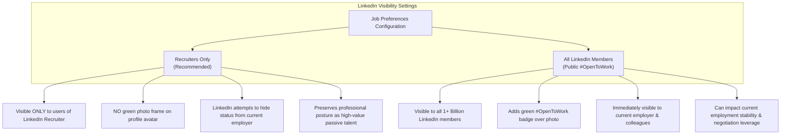

# LinkedIn Job Preferences Optimization Guide & Action Checklist
**Candidate:** Mahfouz Salah Suleiman  
**Current Capacity:** Facilities / MEP Department Manager – Consultant-Side Technical Oversight, Egyptian International Architecture Group (Mega Plan)  
**Target Roles:** Facilities Manager | Senior Facilities Manager | MEP Manager | MEP Consultant | MEP Coordination / Technical Office Engineer  
**Target Markets:** Egypt | Saudi Arabia (KSA) | United Arab Emirates (UAE) | Qatar | Kuwait  
**Context:** Tailored guidance in response to LinkedIn recruiter notification (Melissa Torres) to optimize "Open to Work" job preferences for maximum recruiter discoverability and strict privacy protection.

---

## Executive Summary & Guiding Principles

LinkedIn's "Open to Work" / Job Preferences module is the primary filter utilized by corporate talent acquisition teams and executive headhunters using **LinkedIn Recruiter**. Properly configuring these preferences ensures:
1. **Algorithmic Search Discoverability**: Appearing at the top of candidate search pipelines when recruiters filter by specific job titles, geographic locations, and employment types.
2. **Confidentiality & Career Safety**: Shielding job-seeking activity from current employers and professional colleagues.
3. **Data Integrity & Consistency**: Maintaining 100% harmony with Mahfouz's updated Master Reference, 2-page Executive CV, 3-page Portfolio, and live GitHub Pages website.

> [!IMPORTANT]
> **Zero Automated Changes Notice**: In strict accordance with user security and privacy rules, **no settings on LinkedIn have been altered, submitted, or published**. This guide serves as a verified, ready-to-use blueprint for Mahfouz to review and configure directly.

---

## 1. Evaluation & Ranking of Candidate Job Titles

LinkedIn restricts the "Job Titles" field to a **maximum of 5 titles**. Therefore, titles must be rigorously prioritized based on recruiter search volume, alignment with verified accomplishments across commercial malls, and career positioning.

Below is the detailed evaluation of the seven MEP titles requested, ranked from strongest to weakest alignment:

### Tier 1: Highly Recommended (Exact Match to Verified Experience)

#### 1. `MEP Coordination Engineer` — Rank #1 (MEP Track)
* **Alignment Score**: **10/10 (Highest)**
* **Verified Evidence**: Matches Mahfouz's exact daily responsibilities across Mega Plan's portfolio of 8 commercial developments. Across 75+ retail tenant interfaces—including 20+ tenants at Madinat Masr (Arena, Taj, Kinda), 10 tenants at Sky Walk, and 35+ tenants at Muse Mall—his primary function is coordinating MEP layouts, service corridors, riser capacities, and architectural ceiling voids.
* **Recruiter Appeal**: Highly searched by developers, main contractors, and project management consultancies (PMCs) in KSA and the UAE managing shopping malls and mixed-use commercial assets.

#### 2. `MEP Consultant` — Rank #2 (MEP Track)
* **Alignment Score**: **9.5/10 (High)**
* **Verified Evidence**: Directly reflects his current official capacity at Mega Plan since October 2024 ("Consultant-side technical oversight"). He represents the engineering consultant reviewing tenant submissions, issuing technical comments, witnessing testing & commissioning, and conducting technical snagging.
* **Recruiter Appeal**: Pre-qualifies him for PMC, client-representative, and engineering advisory roles in Riyadh, Dubai, and Cairo.

#### 3. `MEP Technical Office Engineer` — Rank #3 (MEP Track)
* **Alignment Score**: **9/10 (High)**
* **Verified Evidence**: Directly substantiates his core technical office deliverables: reviewing tenant shop drawings (single-line diagrams, ducting routes, water/drainage schematics, fire alarm loops), checking load schedules against base-building allocations, and maintaining review tracking logs.
* **Recruiter Appeal**: High search frequency for commercial fit-out projects where rigorous drawing control is required prior to on-site execution.

---

### Tier 2: Strong Secondary Matches (Broad Appeal & Senior Delivery)

#### 4. `MEP Project Engineer` — Rank #4 (MEP Track)
* **Alignment Score**: **8.5/10 (Strong)**
* **Verified Evidence**: Reflects the bridge between technical office review and site implementation. At Sky Walk (10 tenants) and Muse Mall (35+ tenants), Mahfouz followed up physical execution, verified tie-ins, and resolved field clashes.
* **Recruiter Appeal**: Standard industry title for engineers who govern MEP packages from submittals through site execution, testing, and handover.

#### 5. `MEP Engineer` — Rank #5 (MEP Track)
* **Alignment Score**: **8/10 (Broad Net)**
* **Verified Evidence**: Supported by his 15+ years of continuous electrical and MEP systems experience across municipal infrastructure, commercial retail complexes, and shopping malls.
* **Recruiter Appeal**: The single highest-volume search term on LinkedIn Recruiter. Essential as an algorithmic catch-all, though less specialized than `MEP Coordination Engineer`.

#### 6. `MEP Site Engineer` — Rank #6 (MEP Track)
* **Alignment Score**: **7/10 (Context-Dependent)**
* **Verified Evidence**: Fully supported by his on-site supervision at Muse Mall, Cross 10 Mall, and Hyper One.
* **Strategic Consideration**: In the Gulf market (KSA/UAE), "MEP Site Engineer" is frequently categorized as an entry-to-mid-level position (3–7 years experience) requiring full-time shift standing on site. Given Mahfouz's 15+ years of experience and past 7-year department leadership, labeling himself as a pure Site Engineer may under-position his supervisory seniority.

---

### Tier 3: Requires Verification / Conditional Recommendation

#### 7. `MEP Technical Office Manager` — Conditional Match
* **Alignment Score**: **6/10 (Requires Verification)**
* **Analysis & Verification Need**:
  * **Seniority & Leadership**: Mahfouz has 15+ years of experience, holds an AUC Applied Supervisory Diploma, and successfully directed a 25-person department (including 3 engineers and 4 supervisors) at Cross 10 Mall.
  * **Specific Role Constraint**: At Mega Plan, his role is consultant-side technical oversight across 8 malls, but **no direct reports or line-managed technical office staff** have been confirmed.
  * **GCC Market Standards**: In Saudi Arabia and the UAE, an "MEP Technical Office Manager" typically oversees a dedicated team of junior design engineers, draftspersons, and BIM modelers generating detailed tender/shop drawings and conducting automated Revit/Navisworks clash detection. Mahfouz's verified scope is **reviewing and coordinating submitted tenant drawings and monitoring execution**, rather than managing an in-house design production department.
  * **Recommendation**: Do **not** select `MEP Technical Office Manager` at this stage unless Mahfouz specifically confirms he has directly led technical office design teams. Selecting `MEP Consultant`, `MEP Manager`, or `Facilities Manager` provides stronger credibility and aligns with verified facts.

---

### Recommended 5-Title Selection Strategies

Because LinkedIn permits exactly **5 titles**, Mahfouz should select one of the following two strategic combinations depending on his primary career objective:

#### Strategy A: The Dual-Track Executive (RECOMMENDED)
*Bridges his 7+ years of shopping mall operational leadership with his recent consultant-side MEP oversight across 8 commercial malls.*
1. `Facilities Manager`
2. `MEP Manager`
3. `MEP Consultant`
4. `MEP Coordination Engineer`
5. `MEP Technical Office Engineer`

#### Strategy B: The Pure MEP & Engineering Consulting Track
*Focuses 100% on consultant-side technical office reviews, site supervision, and tenant fit-out delivery.*
1. `MEP Consultant`
2. `MEP Coordination Engineer`
3. `MEP Technical Office Engineer`
4. `MEP Project Engineer`
5. `MEP Engineer` (or `MEP Manager`)

---

## 2. Recommended Job Locations & Work Arrangements

### A. Location Recommendations
LinkedIn allows up to **5 on-site locations**.

1. **Egypt (Confirmed Current Location)**:
   * `Cairo, Egypt` *(Primary regional capital, master-planned developments)*
   * `Giza, Egypt` *(Commercial developments in 6th of October City / Sheikh Zayed)*
   * `10th of Ramadan City, Egypt` *(Industrial & commercial hub where Cross 10 Mall was operated)*

2. **Gulf Markets (Subject to Relocation Confirmation)**:
   * `Riyadh, Saudi Arabia` *(Highest market demand for retail mall FM and MEP fit-out coordination under Vision 2030)*
   * `Jeddah, Saudi Arabia` *(Major commercial, retail, and hospitality center)*
   * `Dubai, United Arab Emirates` *(Premier regional benchmark for shopping malls and retail fit-outs)*
   * `Abu Dhabi, United Arab Emirates` *(Expanding commercial and retail asset management market)*
   * `Doha, Qatar` *(Secondary high-value retail market)*

### B. Work Arrangements (On-Site vs. Hybrid vs. Remote)
* **On-Site (Essential — Check YES)**: Commercial shopping mall facilities management, MEP site supervision, contractor handover, and Civil Defense inspections are physically anchored to real estate assets. This must be enabled.
* **Hybrid (Recommended — Check YES)**: Highly compatible with consultant-side technical office reviews, shop-drawing audits, submittal coordination, and reporting.
* **Remote (Conditional — Optional)**: While full-time mall roles cannot be performed remotely, enabling remote can expose Mahfouz to independent drawing review, fit-out design auditing, or MEP consulting contracts. *However, do not set "Remote only", as this would eliminate 95% of relevant mall FM/MEP leadership vacancies.*

---

## 3. Recommended Opportunity Types & Timing

### A. Job Types (Employment Types)
* **Full-time (Check YES)**: The core vehicle for senior facilities and engineering roles. Matches his continuous 15-year career history.
* **Contract (Check YES)**: Highly advantageous in the GCC and Egypt for commercial malls. Many master developers and PMCs hire MEP Coordination Consultants and Fit-Out Managers on 1- to 3-year fixed contracts tied to mall construction, tenant fit-out, and opening phases.
* **Part-time / Temporary / Internship (Leave UNCHECKED)**: Dilutes executive seniority and triggers irrelevant recruiter solicitations.

### B. Start Date Preference
* **Option 1: "Immediately, I'm actively applying"**: Choose this if Mahfouz is ready to interview immediately and transition to a new opportunity within his standard notice period.
* **Option 2: "Flexible, I'm casually browsing"**: Choose this if Mahfouz prefers a discreet, exploratory posture while continuing his consultant work at Mega Plan.

---

## 4. Open-to-Work Visibility: Privacy & Risk Analysis

LinkedIn provides two visibility levels for job preferences. Understanding the operational distinction is critical:

### Detailed Comparison:

| Feature | Recruiters Only (Recommended) | All LinkedIn Members (Public) |
| :--- | :--- | :--- |
| **Profile Photo Badge** | **No badge** (Profile remains clean, executive, and unchanged). | **Green `#OpenToWork` banner** superimposed on photo. |
| **Who Sees It?** | Only subscribed users of **LinkedIn Recruiter** outside his company. | Every LinkedIn user, including colleagues, clients, and competitors. |
| **Current Employer Visibility** | LinkedIn algorithmically restricts recruiters at his current documented employer (**Mega Plan**) from seeing his status. *(Note: LinkedIn cannot guarantee 100% masking if recruiters use personal accounts)*. | **100% visible** to current employer, managers, and coworkers immediately. |
| **Executive Perception** | Positions Mahfouz as a **sought-after, employed professional** open to the right strategic move. Preserves maximum compensation bargaining power. | May be perceived by regional hiring managers as unemployed or under urgent pressure, potentially weakening salary leverage. |
| **Recommendation** | **STRONGLY RECOMMENDED** | **NOT RECOMMENDED** while currently active at Mega Plan. |

---

## 5. Ready-to-Use LinkedIn Job Preferences Checklist

Mahfouz can open the LinkedIn mobile app or desktop browser and apply these exact settings in under 3 minutes:

### Step-by-Step Action Checklist:

1. **Navigate to Open to Work**:
   * Open LinkedIn profile: `https://www.linkedin.com/in/mahfouz-salah-suleiman-9058b2207/`
   * Click the **"Open to"** button directly beneath the profile header.
   * Select **"Finding a new job"**.

2. **Job Titles (Add up to 5 titles)**:
   * [ ] `Facilities Manager` *(or `MEP Project Engineer` if focusing exclusively on MEP)*
   * [ ] `MEP Manager`
   * [ ] `MEP Consultant`
   * [ ] `MEP Coordination Engineer`
   * [ ] `MEP Technical Office Engineer`

3. **Location Types**:
   * [ ] Check **On-site**
   * [ ] Check **Hybrid**
   * [ ] *(Optional)* Check **Remote** if open to freelance drawing audits

4. **Locations (On-site / Hybrid - up to 5 locations)**:
   * [ ] `Cairo, Egypt`
   * [ ] `Riyadh, Saudi Arabia`
   * [ ] `Dubai, United Arab Emirates`
   * [ ] `Jeddah, Saudi Arabia`
   * [ ] `Abu Dhabi, United Arab Emirates` *(or `Giza, Egypt` if prioritizing local)*

5. **Start Date**:
   * [ ] Select **"Immediately, I'm actively applying"** *(if seeking rapid placement)*  
     *OR*
   * [ ] Select **"Flexible, I'm casually browsing"** *(if exploring discreetly)*

6. **Employment Types**:
   * [ ] Check **Full-time**
   * [ ] Check **Contract**
   * [ ] Ensure *Part-time*, *Internship*, and *Temporary* are **unchecked**

7. **Visibility (CRITICAL)**:
   * [ ] Select **"Recruiters only"** *(Do NOT select "All LinkedIn members")*

8. **Save**:
   * [ ] Click **"Save"** (or **"Add to profile"**).

---

## 6. Open Questions Requiring Mahfouz's Confirmation

Before finalizing these settings, Mahfouz should confirm the following three practical parameters:

1. **Relocation Readiness**: Is he prepared to relocate immediately to Saudi Arabia (Riyadh/Jeddah) or the UAE (Dubai/Abu Dhabi) upon receiving a formal offer, and if so, on a single-status or family-status basis? *(If not currently open to relocation, locations should be limited strictly to Egypt: Cairo, Giza, New Cairo).*
2. **Career Track Priority**: Does he want recruiters to approach him primarily for **Full Facilities Management leadership** (commercial mall O&M, maintenance contracts, team leadership) or **MEP Consulting & Technical Office coordination** (drawing reviews, tenant fit-outs, site supervision)?
3. **Availability & Notice Period**: What is his expected contractual notice period with Mega Plan (e.g., 30 days, 60 days, or immediate availability)?
