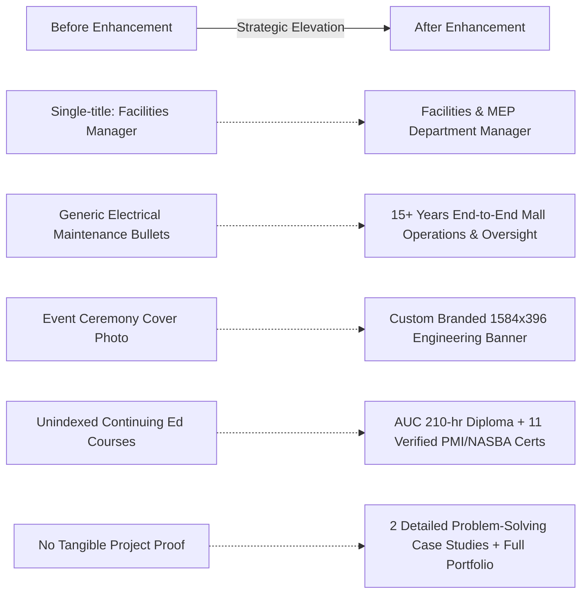

# Comprehensive LinkedIn Profile Audit, Strategy & Enhancement Master Plan
**Candidate:** Mahfouz Salah Suleiman (Mahfouz Salah Mahfouz Soliman)  
**Target Roles:** Facilities Manager | Senior Facilities Manager | MEP Manager | Facilities & MEP Department Manager  
**Target Markets:** Saudi Arabia (KSA) | United Arab Emirates (UAE) | Egypt | Kuwait | Qatar  
**Document Status:** Complete Strategy & Ready-to-Publish Blueprint  
**Primary Source of Truth:** Master Reference Profile, Extended Master Reference, Master CV & Portfolio (.docx/.pdf), Scanned Verified Credentials (مستنداتي.pdf), Portfolio Website Source Files (index.html).

---

## Table of Contents
1. [Deliverable 1: Comprehensive Profile Audit Report (All 17 Sections)](#deliverable-1-comprehensive-profile-audit-report)
2. [Deliverable 2: Professional Positioning & 3 Tailored Headlines](#deliverable-2-professional-positioning--3-tailored-headlines)
3. [Deliverable 3: Final About Section & Concise Alternative](#deliverable-3-final-about-section--concise-alternative)
4. [Deliverable 4: Ready-to-Paste Experience Entries (All 5 Employers)](#deliverable-4-ready-to-paste-experience-entries)
5. [Deliverable 5: Prioritized Skills Strategy & Taxonomy](#deliverable-5-prioritized-skills-strategy--taxonomy)
6. [Deliverable 6: Reviewed Education, Professional Diplomas & Certifications](#deliverable-6-reviewed-education-professional-diplomas--certifications)
7. [Deliverable 7: Featured Section Strategy & Asset Curation](#deliverable-7-featured-section-strategy--asset-curation)
8. [Deliverable 8: Project Case Studies (LinkedIn Long-Form Format)](#deliverable-8-project-case-studies)
9. [Deliverable 9: Profile Photo & Custom Cover Banner Direction](#deliverable-9-profile-photo--custom-cover-banner-direction)
10. [Deliverable 10: Fact-Checking & Integrity Register](#deliverable-10-fact-checking--integrity-register)
11. [Deliverable 11: Profile Publishing & Rollout Checklist](#deliverable-11-profile-publishing--rollout-checklist)
12. [Deliverable 12: Executive Impact Summary](#deliverable-12-executive-impact-summary)

---

## Deliverable 1: Comprehensive Profile Audit Report

> [!NOTE]
> **Audit Methodology & Access Notice**: This audit was conducted using the candidate's verified source documentation, master CV, extended master reference profile, portfolio website codebase, scanned credentials (مستنداتي.pdf), and the baseline LinkedIn profile information visible in candidate records. Direct live account modifications have not been executed, ensuring zero unapproved edits.

Below is an exhaustive section-by-section audit across all 17 critical profile components, evaluated against executive search standards in Saudi Arabia, the United Arab Emirates, Egypt, Kuwait, and Qatar.

| # | Profile Section | Baseline / Current State | Strategic Weaknesses & Risks | Recommended Enhancement | Priority |
|---|---|---|---|---|---|
| **1** | **Profile Photo** | Wide event photograph at an American University in Cairo (AUC) podium with graduation sash. | Setting distracts from facial features; podium occupies the bottom half; informal framing prevents instant recognition in mobile recruiter searches. | Replace with an executive headshot cropped from chest-up, centered on face, neutral professional attire (dark suit, blue tie), and uncluttered background. | **High** |
| **2** | **Cover / Banner Image** | Wide group graduation photo from AUC continuing education ceremony. | Visually cluttered; lacks industry-specific visual context (FM, MEP, Commercial Malls); profile avatar obscures left portion of the group; no value proposition. | Deploy custom 1584x396px branded banner with deep navy (#0A192F) and teal (#00A389) palette, architectural line accents, and clear specialization tagline. | **High** |
| **3** | **Name & Identity** | Mahfouz Salah Suleiman | Inconsistent naming across documents (CV uses Mahfouz Salah Mahfouz Soliman). Recruiter searchability is split. | Maintain Mahfouz Salah Suleiman on LinkedIn for brand recognition, adding official Arabic name محفوظ صلاح سليمان in the alternative name field for regional ATS discovery. | **Medium** |
| **4** | **Headline** | Facilities Manager at Egyptian International Architecture Group / Mega Plan | Passive, company-bound title. Misses 75% of primary search keywords (MEP Manager, Shopping Mall Operations, Retail Fit-Out, Tenant Coordination, KSA / UAE). | Implement a multi-pillar executive headline utilizing full 220-character allocation with high-frequency recruiter search terms. | **Critical** |
| **5** | **About Section** | Brief summary or blank baseline focused purely on electrical engineering roots. | Fails to narrate career progression from electrical maintenance to full-asset facilities management and consultant oversight; lacks verified impact examples. | Full rewrite into a structured narrative: Hook, Career Evolution, Dual Technical/Operational Strengths, 2 Verified Problem-Solving Examples, and GCC target direction. | **Critical** |
| **6** | **Current Position** | Facility Manager at Egyptian International Architecture Group (Mega Plan) | Risk of implying direct line-management of staff or commercial certification duties, which conflicts with actual consultant oversight scope. | Retitle to Facilities / MEP Department Manager – Consultant-side Technical Oversight. Frame duties strictly around design/shop-drawing review, inspection, snagging, testing & commissioning, and Civil Defense compliance across 4 malls. | **Critical** |
| **7** | **Previous Experience** | 4 prior roles with uneven, generic bullet points (Managed electrical systems, Conducted routine inspections). | Missing quantification (asset sizes, team structures, contractor values); does not showcase shopping mall operations (Cross 10 Mall, 22,000 m²) or retail tenant names. | Rewrite all 4 historical entries with 5–8 evidence-based bullets, distinguishing the 25-person team leadership at Cross 10 Mall and practical equipment engineering. | **Critical** |
| **8** | **Education** | Bachelor of Electronics Technology, Helwan University, 2009 | Minor wording discrepancy with official degree nomenclature; misses the graduation project distinction. | Update degree to: Bachelor of Industrial Education, Electronics Technology Department, Helwan University (2009). Highlight graduation project: *Design of Miniature Laboratory System for Voltage & Current Measurements* (Grade: Excellent). | **Medium** |
| **9** | **Licenses & Certifications** | Mixture of informal course listings; occasional confusion with PMP credentials. | Risk of ATS misclassification or false PMP claims. Short courses must not be conflated with government/board licenses. | Separate formal diploma: Applied Supervisory Professional Diploma (AUC School of Continuing Education, 210 contact hours) from PMI-aligned short courses. Zero false claims of PMP certification. | **Critical** |
| **10** | **Skills Section** | Unordered collection of general skills (e.g., Management, Engineering, Teamwork). | Low keyword density for MEP/FM search queries; core competencies buried; unverified skills diluting relevance. | Reorder and pin Top 3 skills (Facilities Management, MEP Coordination, Commercial Mall Operations). Add technical taxonomy covering HVAC, Firefighting, Civil Defense, and Fit-Outs. | **High** |
| **11** | **Featured Section** | Empty or linking to outdated, unformatted files. | Misses prime profile real estate to showcase technical deliverables, portfolio documents, and verified case studies. | Curate 5 top-tier media items: Master CV (PDF), Professional Portfolio (PDF), Portfolio Website link, Water Supply Case Study, and Drainage Remediation Case Study. | **High** |
| **12** | **Projects Section** | Underutilized or unlisted individual mall projects. | Mega Plan's 4 commercial malls and Cross 10 Mall are not linked to searchable project cards. | Create structured Project entries for Cross 10 Mall, Souq El Madina Mall, East Plaza Mall, Kayan Plaza Mall, and 60 Feddan Club Mall. | **Medium** |
| **13** | **Courses Section** | Scattered or partially documented LinkedIn Learning completions. | Lacks verified metadata (PMI Registered Education Provider ID #4101, CPE credits, Certificate IDs). | Populate all 11 verified courses with exact completion dates, PDUs/CPEs, and Certificate IDs matching مستنداتي.pdf. | **Medium** |
| **14** | **Recommendations** | Zero received or outdated peer recommendations. | Limits social proof and peer validation for senior FM/MEP leadership roles in the GCC. | Deploy targeted outreach to former managers, consultants, and contractors requesting specific recommendations on technical oversight and team leadership. | **Medium** |
| **15** | **Accomplishments & Awards** | No structured awards or honors listed. | Academic excellence (Graduation Project Grade: Excellent) and major cost-optimization achievements are unindexed. | Index academic honors and project problem-solving milestones in the Accomplishments module. | **Low** |
| **16** | **Contact Information** | Basic email only; phone numbers and professional links missing. | Slows recruiter outreach; lacks verified professional portfolio link. | Add verified contact email (Mahfouzsoliman2021@gmail.com), active mobile numbers (+201027629474, +201221833667), and live portfolio web address. | **High** |
| **17** | **Profile URL & Consistency** | Standard numeric URL (/in/mahfouz-salah-suleiman-9058b2207/). | Suboptimal vanity URL; facts across CV, Portfolio, and LinkedIn have minor discrepancies (e.g. titles, dates). | Standardize vanity URL to /in/mahfouz-salah-suleiman (if available); enforce 100% data harmonization across CV, Portfolio, and LinkedIn. | **Medium** |

---

## Deliverable 2: Professional Positioning & 3 Tailored Headlines

### 1. Strategic Positioning Architecture
The target markets (Saudi Arabia, United Arab Emirates, Egypt, Kuwait, and Qatar) require a distinct dual-capability profile for high-value commercial properties and shopping centers:
1. **Operational Asset Management (FM)**: Hands-on lifecycle operations, preventive & corrective maintenance (PPM/CM), utility optimization, SLA/KPI contractor supervision, and tenant fit-out coordination.
2. **Technical Engineering Delivery (MEP)**: Rigorous consultant-side engineering oversight, design & shop-drawing audits, installation compliance, testing & commissioning (T&C), technical snagging, and civil defense life-safety compliance.

Recruiters in Riyadh, Jeddah, Dubai, Abu Dhabi, and Doha actively search for hybrid professionals who understand both the engineering precision of MEP systems during execution/handover and the operational demands of running a live commercial shopping mall.

---

### 2. Three Tailored Headline Options (Within LinkedIn 220-Character Limit)

#### Option 1: Facilities Management-Focused
> **Headline Text:**  
> `Facilities Manager | Shopping Mall Operations & Asset Management | MEP Infrastructure, Preventive Maintenance (O&M), Tenant Fit-Outs & Contractor Management | AUC Applied Supervisory Diploma | Cairo • KSA • UAE`  
> *(Total Length: 219 characters / 220 max)*

* **Strategic Positioning**: Centers firmly on operational leadership, shopping mall management, asset reliability, maintenance contracts, and tenant relations.
* **Recruiter Keyword Footprint**: `Facilities Manager`, `Shopping Mall Operations`, `Asset Management`, `MEP Infrastructure`, `Preventive Maintenance`, `Tenant Fit-Outs`, `Contractor Management`, `AUC`, `KSA`, `UAE`.
* **Trade-Off Analysis**:
  * *Strengths*: Highly attractive to retail mall operators, property management firms, and commercial asset owners seeking a full-scope Facilities Manager.
  * *Trade-offs*: Slightly de-emphasizes deep engineering review and consultant-side design audits.

---

#### Option 2: MEP & Technical Delivery-Focused
> **Headline Text:**  
> `MEP Manager | Consultant-Side Technical Oversight & Engineering Review | Commercial Malls, Retail Fit-Outs, Testing & Commissioning, Snagging & Handover | Civil Defense & Life Safety | KSA • UAE • Qatar • Egypt`  
> *(Total Length: 216 characters / 220 max)*

* **Strategic Positioning**: Centers on technical engineering excellence, design/shop-drawing review, construction monitoring, MEP inspections, and technical handover across multi-mall portfolios.
* **Recruiter Keyword Footprint**: `MEP Manager`, `Technical Oversight`, `Engineering Review`, `Commercial Malls`, `Retail Fit-Outs`, `Testing & Commissioning`, `Snagging & Handover`, `Civil Defense`, `Life Safety`.
* **Trade-Off Analysis**:
  * *Strengths*: Highly competitive for engineering consultancies, PMCs, and master developers looking for technical MEP managers to govern contractors and fit-outs.
  * *Trade-offs*: Downplays long-term operational facilities management, team leadership, and routine mall maintenance operations.

---

#### Option 3: Balanced Facilities & MEP Leadership-Focused (RECOMMENDED)
> **Headline Text:**  
> `Facilities & MEP Department Manager | Commercial Shopping Malls & Retail Fit-Outs | Consultant-Side Technical Oversight, Preventive Maintenance (O&M), Testing & Handover | AUC Diploma | KSA • UAE • Qatar • Egypt`  
> *(Total Length: 218 characters / 220 max)*

* **Strategic Positioning**: The optimal executive synthesis. Bridges consultant-side engineering scrutiny (Mega Plan's 4 malls) with extensive 8-year shopping mall operational leadership (Cross 10 Mall's 25-person team).
* **Recruiter Keyword Footprint**: `Facilities & MEP Department Manager`, `Commercial Shopping Malls`, `Retail Fit-Outs`, `Consultant-Side Technical Oversight`, `Preventive Maintenance`, `O&M`, `Testing & Handover`, `AUC Diploma`, `KSA`, `UAE`, `Qatar`, `Egypt`.
* **Why This Option Is Strongly Recommended**:
  * Captures executive search queries for **both** `Facilities Manager / Senior Facilities Manager` and `MEP Manager`.
  * Communicates seniority (`Department Manager`) while strictly adhering to confirmed facts.
  * Highlights specialized commercial mall and retail fit-out experience, which commands premium compensation in the Gulf region.
  * Signals geographic openness across the primary target markets (KSA, UAE, Qatar, Egypt).

---

### 3. Gulf Recruiter Search & Boolean Matching Strategy
Recruiters in KSA and the UAE utilize complex Boolean search strings in LinkedIn Recruiter. Option 3 ensures matches against key Boolean algorithms:
```text
("Facilities Manager" OR "MEP Manager" OR "Facilities & MEP Manager") 
AND ("Mall" OR "Shopping Center" OR "Commercial") 
AND ("Fit-Out" OR "Fitout" OR "Handover" OR "Testing & Commissioning") 
AND ("Maintenance" OR "O&M" OR "Civil Defense")
```

---

## Deliverable 3: Final About Section & Concise Alternative

### 1. Recommended Master About Section (Full Narrative)
*Copy and paste directly into LinkedIn's About module (2,600-character limit; this draft is ~1,950 characters, leaving optimal whitespace for scanning).*

```markdown
I am a Facilities and MEP Professional with over 15 years of technical and operational experience spanning commercial shopping mall developments, retail fit-outs, facility operations, and consultant-side engineering oversight.

My career progression bridges practical engineering foundations with high-level asset management. Starting with hands-on electrical maintenance and heavy equipment reliability, I advanced into facilities supervision and long-term shopping mall operations, before taking on my current role delivering consultant-side technical oversight across a portfolio of commercial malls.

At Egyptian International Architecture Group (Mega Plan), I provide consultant-side technical oversight across four commercial mall developments: East Plaza Mall, Kayan Plaza Mall, Souq El Madina Mall, and 60 Feddan Club Mall. My mandate focuses on engineering rigor: reviewing MEP designs, calculations, technical specifications, and shop drawings; following execution progress step by step; coordinating inspections, testing, and handover; preparing comprehensive technical snag lists; and overseeing technical compliance with applicable Civil Defense fire and life-safety requirements. In addition, I periodically review approximately 11 tenant fit-outs across the mall portfolio to ensure structural and MEP interface compliance.

Previously, at Al-Amal for Development and Trade, I served as Facilities Manager for Cross 10 Mall in 10th of Ramadan City (~22,000 m²). I supported the asset across its lifecycle—from late construction and fit-out through operational handover and long-term facility management. I directed a 25-person facilities team (3 engineers, 4 supervisors, and technicians/operators), administered maintenance contracts valued at approximately EGP 150,000/month based on strict response and repair KPIs, managed operating budgets, monitored power and water consumption, and instituted structured inventory tracking. I supervised fit-outs and operational interfaces for major retail brands including Vodafone, Seif Pharmacy, Adidas, Active, National Bank of Egypt, Smart Furniture, 2B, and Tseppas.

My approach combines engineering precision with practical problem-solving:
• Route Optimization: At Cross 10 Mall, coordinated with adjacent site stakeholders to identify a closer alternative water-supply route, avoiding the originally planned booster-pump approach and reducing the estimated connection expenditure from ~EGP 5M to ~EGP 750k (indicative project estimate).
• System Rehabilitation: At Souq El Madina Mall, resolved chronic concrete-slab drainage leakage by re-routing lines at correct gradients, creating dedicated shop-to-main inspection chambers, rehabilitating lift pumps with an alternating sequence, and integrating restaurant grease traps.

Core Technical & Management Competencies:
• Facilities Operations: Preventive & Corrective Maintenance (PPM/CM), Operating Budgets, Utility Monitoring, SLA/KPI Tracking.
• MEP Technical Delivery: Shop Drawing Review, Installation Monitoring, Testing & Commissioning (T&C), Snagging, Handover.
• Retail Mall Management: Tenant Fit-Out Coordination, Retail Interfaces, Civil Defense / Life Safety Compliance.
• Systems Covered: Electrical Distribution, HVAC, Firefighting, Fire Alarms, Plumbing & Drainage, Pumps & Controls.

Education & Credentials:
• Bachelor of Industrial Education, Electronics Technology Dept. – Helwan University (Graduation Project Grade: Excellent)
• Applied Supervisory Professional Diploma (210 Contact Hours) – AUC School of Continuing Education

Targeting Senior Facilities Manager, Facilities Manager, and MEP Manager appointments across Saudi Arabia (KSA), United Arab Emirates (UAE), Qatar, Kuwait, and Egypt.

Contact: Mahfouzsoliman2021@gmail.com | +2 01027629474 | +2 01221833667
LinkedIn: linkedin.com/in/mahfouz-salah-suleiman-9058b2207
```

---

### 2. Shorter Alternative Version (Quick-Scan Mobile Format)
*Ideal for recruiters scanning primarily via smartphone (approx. 1,150 characters).*

```markdown
Facilities & MEP Professional with 15+ years of experience across commercial shopping malls, retail tenant fit-outs, facility operations (O&M), and consultant-side engineering oversight in Egypt.

KEY VALUE DELIVERED:
• Consultant-Side Technical Oversight: Currently overseeing MEP works across 4 commercial malls (East Plaza, Kayan Plaza, Souq El Madina, 60 Feddan Club Malls) at Mega Plan. Responsibilities center on design and shop-drawing audits, installation monitoring, testing & commissioning, technical snagging, Civil Defense compliance, and periodic review of ~11 retail fit-outs.
• Full Mall Facilities Operations: Formerly Facilities Manager at Al-Amal for Cross 10 Mall (~22,000 m²), leading a 25-person operations team, governing ~EGP 150k/month maintenance contracts, managing operating budgets, and coordinating fit-outs for leading brands (Vodafone, Adidas, NBE, Seif Pharmacy).
• Practical Engineering Problem-Solving: Identified alternative water-supply routing avoiding booster pumps (Cross 10 Mall) and rehabilitated defective drainage gradients/pumps to halt chronic slab leakage (Souq El Madina Mall).

CORE EXPERTISE:
Facilities Management | MEP Technical Oversight | Preventive & Corrective Maintenance | Commercial Mall Operations | Retail Fit-Out Supervision | Civil Defense Compliance | Testing & Handover | Utility Monitoring.

Credentials:
• Bachelor of Industrial Education (Electronics Technology) – Helwan University
• Applied Supervisory Professional Diploma (210 hrs) – AUC School of Continuing Education

Open to executive FM & MEP leadership opportunities in KSA, UAE, Qatar, Kuwait, and Egypt.
Direct: Mahfouzsoliman2021@gmail.com | +2 01027629474 | +2 01221833667
```

---

## Deliverable 4: Ready-to-Paste Experience Entries

### 1. Egyptian International Architecture Group (Mega Plan)
* **Dates**: October 2024 – Present
* **Location**: Cairo, Egypt
* **Recommended LinkedIn Title**: `Facilities / MEP Department Manager – Consultant-Side Technical Oversight`
* **Official Baseline Title**: `Facilities / MEP Department Manager`
* **Role Classification**: Consultant-Side Engineering Oversight & Quality Governance

#### Role Overview
Delivering consultant-side technical oversight, engineering drawing reviews, and execution supervision across 8 commercial mall developments in Egypt, including **Madinat Masr Developments** (Mall Arena at Sarai, Mall Taj at Taj City, Mall Kinda), **Sky Walk** (6th of October City), **Muse Mall** (near Al Naib Al Aam Bridge), **East Plaza Mall**, **Kayan Plaza Mall**, **Souq El Madina Mall**, and **60 Feddan Club Mall**. Governing MEP engineering compliance, tenant drawing reviews, and site execution across 75+ commercial retail tenants. Acting as the technical authority ensuring contractor installations adhere strictly to engineering designs, approved shop drawings, local codes, and Civil Defense fire/life-safety standards.

#### Ready-to-Paste Bullets
* **Portfolio-Wide Technical Oversight**: Deliver consultant-side engineering reviews, shop drawing audits, and execution supervision across 8 commercial mall developments in Egypt.
* **Madinat Masr Developments (20+ Tenants)**: Review and coordinate technical MEP drawings and supervise execution works for 20+ commercial retail tenants collectively across Mall Arena (Sarai Compound), Mall Taj (Taj City Compound), and Mall Kinda.
* **Sky Walk Commercial Center (10 Tenants)**: Conduct technical drawing reviews for 10 retail tenants in 6th of October City, coordinating utility connections and following up on MEP site execution.
* **Muse Mall Site Supervision (35+ Tenants)**: Supervise high-volume MEP site execution and coordinate multi-tenant technical interfaces for 35+ retail tenants near Al Naib Al Aam Bridge.
* **Engineering Audits & Snagging Governance**: Review MEP designs, specifications, and contractor shop drawings across East Plaza, Kayan Plaza, Souq El Madina, and 60 Feddan Club Malls; monitor execution, compile technical snag lists, and oversee testing & handover.
* **Civil Defense & Life-Safety Coordination**: Coordinate compliance with Egyptian Civil Defense requirements, verifying fire protection, sprinkler networks, fire alarm loops, and smoke control systems across retail tenant fit-outs and common mall areas.
* **Stakeholder Diplomacy & Technical Alignment**: Facilitate proactive technical coordination among project developers, lead consultants, MEP contractors, and commercial tenant engineering representatives.

#### Strategic Metadata
* **Core Keywords**: `Consultant-Side Technical Oversight`, `MEP Engineering Review`, `Shop Drawing Review`, `Testing & Commissioning (T&C)`, `Technical Snagging`, `Retail Tenant Fit-Outs`, `Civil Defense Compliance`, `Commercial Malls`, `Fire & Life Safety`.
* **Scope Boundary & Integrity Guard**: *Confirmed: This role focuses on consultant-side technical oversight and quality governance. It does NOT claim direct-line subordinate management, quantity surveying, or payment certificate authorization.*

---

### 2. Al-Amal for Development and Trade
* **Dates**: January 2017 – September 2024 (7 yrs 9 mos)
* **Location**: 10th of Ramadan City, Egypt
* **Recommended LinkedIn Title**: `Facilities Manager / Head of Facilities Department`
* **Official Baseline Title**: `Facilities Manager`
* **Asset Handled**: **Cross 10 Mall** (Commercial Shopping Center, ~22,000 m² Built-Up Area)

#### Role Overview
Led comprehensive facilities operations and maintenance for Cross 10 Mall, managing the asset's full lifecycle from late-stage construction and tenant fit-out through operational commissioning and 7+ years of sustained commercial operation. Directed a 25-person multi-disciplinary facilities team, governed outsourced maintenance contracts, controlled operating budgets, and managed tenant relations for leading national and international retail brands.

#### Ready-to-Paste Bullets
* **Full Asset Facilities Management**: Directed day-to-day operations and maintenance across Cross 10 Mall (~22,000 m²), ensuring continuous reliability of electrical distribution, centralized HVAC, firefighting networks, plumbing/drainage, and building management interfaces.
* **Team Leadership & Resource Allocation**: Managed a dedicated 25-person in-house facilities operations team consisting of 3 engineers, 4 supervisors, and a team of multi-skilled technicians and operational staff, establishing daily task schedules, performance standards, and safety workflows.
* **Preventive & Corrective Maintenance (PPM/CM)**: Instituted structured preventive maintenance schedules for all critical plant machinery (generators, chillers, pumps, switchgear), achieving sustained equipment availability and reducing unplanned corrective downtime.
* **Contractor & SLA/KPI Management**: Governed external service providers and administered monthly maintenance contracts valued at approximately EGP 150,000, enforcing rigorous contractor KPIs around response speed, mean time to repair, and preventive quality.
* **Retail Tenant Fit-Out Coordination**: Supervised MEP fit-outs and operational handovers for tier-1 retail brands and banking institutions, including **Vodafone**, **National Bank of Egypt (NBE)**, **Seif Pharmacy**, **Adidas**, **Active**, **Smart Furniture**, **2B**, and **Tseppas**, ensuring zero disruption to mall trading.
* **Utility & Operational Budget Monitoring**: Monitored and analyzed mall-wide electricity and water consumption trends, identifying operational anomalies and recommending energy/water conservation measures to optimize asset operating expenditures (OPEX).
* **Inventory Control & Stock Management**: Designed and implemented a hybrid Excel and documentation-based store inventory control system for maintenance spare parts and consumables, tracking incoming, outgoing, and returned items to eliminate stockouts.
* **Infrastructure Cost Optimization (Case Study)**: Coordinated with adjacent site stakeholders (Hyper One) to identify and execute an alternative main water-supply connection route, eliminating the requirement for complex booster-pump stations and reducing estimated connection costs from ~EGP 5M to ~EGP 750k (indicative project estimate).

#### Strategic Metadata
* **Core Keywords**: `Facilities Management`, `Building Operations & Maintenance (O&M)`, `Preventive Maintenance (PPM)`, `Team Leadership (25 Staff)`, `Retail Fit-Out Coordination`, `SLA & KPI Management`, `Utility Consumption Monitoring`, `Operating Budgets`, `Cross 10 Mall`.
* **Scope Boundary & Integrity Guard**: *Confirmed: The 25-person team leadership and EGP 150k/month maintenance contract governance belong strictly to this role at Al-Amal.*

---

### 3. Hyper One Trading Company
* **Dates**: November 2016 – January 2017 (3 mos)
* **Location**: Cairo / 10th of Ramadan City, Egypt
* **Recommended LinkedIn Title**: `Facilities Management Supervisor`
* **Official Baseline Title**: `Facilities Management Supervisor`

#### Role Overview
Supervised daily facility operations, maintenance interventions, and site safety standards across a high-traffic retail hypermarket environment, coordinating service providers and ensuring building systems integrity.

#### Ready-to-Paste Bullets
* **Retail Facility Supervision**: Conducted comprehensive daily inspections across sales floors, cold storage facilities, utility rooms, and public concourses to ensure uninterrupted retail operations.
* **Preventive Maintenance Schedules**: Followed up routine maintenance schedules for refrigeration electrical feeds, retail lighting, backup diesel generators, and plumbing infrastructure.
* **Vendor & Service Coordination**: Coordinated with specialized maintenance contractors and facilities vendors, monitoring job execution against quality standards and scope of work.
* **Maintenance Expenditure Tracking**: Supported tracking and verification of routine maintenance work orders and operational expenditures against allocated departmental budgets.
* **HSE & Safety Regulations**: Enforced occupational health, hygiene, and fire-safety procedures across back-of-house operations, ensuring compliance with commercial retail regulations.

#### Strategic Metadata
* **Core Keywords**: `Facilities Supervision`, `Hypermarket Operations`, `Vendor Coordination`, `Site Inspection`, `HSE Compliance`, `Maintenance Cost Control`.
* **Scope Boundary & Integrity Guard**: *Maintained grounded scope: Details accurately reflect available records without unverified padding.*

---

### 4. Engineering Contracting Office (Ramadan & Hussein Abu Hamid)
* **Dates**: November 2014 – August 2016 (1 yr 10 mos)
* **Location**: Assiut, Egypt
* **Recommended LinkedIn Title**: `Electrical / Equipment Maintenance Engineer`
* **Official Baseline Title**: `Maintenance Engineer`

#### Role Overview
Directed electrical maintenance, breakdown troubleshooting, and operational reliability for heavy road construction machinery, industrial crushing plants, and asphalt production facilities.

#### Ready-to-Paste Bullets
* **Industrial Plant Electrical Maintenance**: Supervised and performed electrical maintenance, control panel wiring, and automation troubleshooting for high-capacity asphalt mixing plants and stone crushing facilities.
* **Heavy Machinery Electrical Reliability**: Maintained electrical and electro-mechanical systems on road-paving machinery, vibratory compactors, heavy transport equipment, and earthmoving fleets.
* **Power Generation & Distribution**: Managed installation, routine servicing, and load balancing of heavy-duty industrial diesel generators supplying off-grid quarry and site operations.
* **Preventive Maintenance Planning**: Formulated and executed structured preventive maintenance routines that minimized unexpected mechanical and electrical plant stoppages during critical project paving phases.
* **Safety & Operational Standards**: Enforced stringent site safety protocols regarding high-voltage machinery, lock-out/tag-out (LOTO) procedures, and workshop tooling maintenance.

#### Strategic Metadata
* **Core Keywords**: `Electrical Maintenance`, `Industrial Plant Maintenance`, `Asphalt Mixers`, `Stone Crushers`, `Diesel Generators`, `Control Panels`, `Preventive Maintenance`, `Machinery Troubleshooting`.

---

### 5. International Contracting Company (Muntaser)
* **Dates**: November 2010 – October 2014 (4 yrs)
* **Location**: Cairo / Giza / Luxor, Egypt
* **Recommended LinkedIn Title**: `Electrical Maintenance Engineer`
* **Official Baseline Title**: `Electrical Maintenance Engineer`

#### Role Overview
Executed electrical engineering maintenance and supervised execution works for municipal public lighting networks, low-voltage distribution grids, and feeder infrastructure across newly developed urban communities in Egypt.

#### Ready-to-Paste Bullets
* **Public Lighting Infrastructure**: Supervised maintenance and operational reliability of extensive municipal public lighting networks across satellite cities, including **Sheikh Zayed**, **15th of May**, **El Shorouk**, and **New Taiba City (Luxor)**.
* **Low-Voltage Distribution Networks**: Inspected, tested, and maintained low-voltage (LV) distribution feeder pillars, street lighting control panels, underground cabling, and transformer step-down connections.
* **Routine Testing & Fault Finding**: Led field technical teams in cable fault localization, insulation resistance testing (megger testing), phase balancing, and timer/photocell lighting automation repairs.
* **Municipal Authority Approvals**: Coordinated directly with municipal development authorities and local utility entities to process site inspections, technical clearances, and official network handovers.
* **Contractor Execution Supervision**: Monitored subcontractor installation quality during lighting network expansion projects, ensuring strict adherence to Egyptian electricity code standards.

#### Strategic Metadata
* **Core Keywords**: `Public Lighting Networks`, `Electrical Maintenance`, `LV Distribution Feeders`, `Cable Fault Localization`, `Transformer Sub-stations`, `Municipal Authority Approvals`, `Infrastructure Handover`.

---

## Deliverable 5: Prioritized Skills Strategy & Taxonomy

### 1. Top 3 Skills Strategy (Must Pin to Top of Profile)
LinkedIn displays only the top 3 pinned skills before requiring a click on "Show all skills". These 3 skills heavily influence search algorithmic ranking and recruiter evaluation:
1. **Facilities Management** *(Primary keyword for FM roles across GCC)*
2. **MEP Coordination** *(Primary keyword bridging consultant oversight & engineering execution)*
3. **Commercial Mall Operations** *(High-value niche differentiator commanding premium compensation)*

---

### 2. Categorized Skill Taxonomy (Mapped to Target Roles)

#### Category 1: Facilities Management & Building Operations
* Facilities Management
* Building Operations & Maintenance (O&M)
* Preventive Maintenance (PPM)
* Corrective Maintenance (CM)
* Maintenance Planning & Scheduling
* Maintenance Contracts & Service Level Agreements (SLAs)
* Contractor Performance & KPI Management
* Operating Budget Monitoring (OPEX)
* Utility Consumption Monitoring (Power & Water)
* Inventory Control & Store Management

#### Category 2: MEP Systems & Technical Engineering
* MEP Systems
* Electrical Distribution Systems
* HVAC (Heating, Ventilation & Air Conditioning)
* Firefighting Systems
* Fire Alarm Systems
* Plumbing and Drainage Systems
* Water Supply & Lift Pumps
* Pump Control Panels & Automation
* Low-Voltage (LV) Distribution
* Backup Diesel Generators
* Technical Drawing Review
* Shop Drawing & Material Submittal Review

#### Category 3: Project Delivery, Inspections & Retail Fit-Outs
* Commercial Shopping Malls
* Retail Tenant Fit-Out Coordination
* Site Inspection & Quality Control
* Testing & Commissioning (T&C)
* Technical Snagging & Snag Lists
* Operational Handover
* Architectural & MEP Interface Coordination
* As-Built Drawing Verification

#### Category 4: Regulatory, Safety & Governance
* Civil Defense Compliance
* Fire & Life Safety Standards
* Occupational Health, Safety & Environment (HSE)
* Work Permits & Site Safety Procedures
* Municipal Authority Clearances

#### Category 5: Engineering & Management Tools
* AutoCAD
* Microsoft Excel (Advanced Tracking & Spreadsheets)
* Microsoft Word (Technical Reporting & Specifications)
* Microsoft PowerPoint (Management Presentations)
* Microsoft 365 Collaboration

---

### 3. Skills Pruning & Integrity Rules
* **Remove / Do Not Claim**:
  * `Project Management Professional (PMP)`: Mahfouz holds PMI-aligned PDU certificates from LinkedIn Learning, but is NOT PMP-certified. Claiming PMP violates professional ethics and invites instant recruiter disqualification upon background screening.
  * `BIM / Revit`: Not documented in verified day-to-day project workflows; AutoCAD is his verified drafting and review platform.
  * `Quantity Surveying / Commercial Valuations`: The user explicitly confirmed that payment certificates and quantity surveying are not part of his scope.
  * Generic fluff skills (`Hard Worker`, `Communication`, `Multi-tasking`): Dilute technical profile weight.

---

## Deliverable 6: Reviewed Education, Professional Diplomas & Certifications

### 1. Formal University Education
* **Degree**: Bachelor of Industrial Education, Electronics Technology Department
* **Institution**: Helwan University (Faculty of Industrial Education)
* **Graduation Year**: 2009
* **Location**: Cairo, Egypt
* **Graduation Project**: *Design of a Miniature Laboratory System for Voltage and Current Measurements*
* **Graduation Project Grade**: **Excellent (امتياز)**
* **LinkedIn Entry Guidance**: Place under **Education**. Use the exact English title `Bachelor of Industrial Education, Electronics Technology Department` to accurately reflect the accreditation.

---

### 2. Executive Professional Diploma
* **Credential**: Applied Supervisory Professional Diploma
* **Institution**: School of Continuing Education (SCE), The American University in Cairo (AUC)
* **Period**: November 4, 2022 – November 3, 2023
* **Academic Volume**: **210 Contact Hours**
* **Location**: Cairo, Egypt
* **LinkedIn Entry Guidance**: Place under **Education** or **Licenses & Certifications** as a Post-Graduate Executive Diploma. Highlight the 210 contact hours to demonstrate substantial leadership and supervisory training from a premier regional institution.

---

### 3. Verified Continuing Professional Education & Courses
*Extracted directly from verified scanned certificates (`مستنداتي.pdf`) with exact Certificate IDs and PMI/NASBA accreditation numbers.*

| Course Title | Issuing Organization | Completion Date | Credit / PDUs / CPEs | Accrediting Body & Activity # | Certificate ID |
|---|---|---|---|---|---|
| **Administrative Professional Foundations** | LinkedIn Learning | Feb 22, 2025 | 44 mins | NASBA / LinkedIn | `2246cd4e44d115daa07db9c4fcb353c1c6dc5b8abf7beaa2165c8c87f3fda6e1` |
| **Collaborating with Microsoft 365** | LinkedIn Learning | Mar 11, 2024 | 48 mins | Microsoft / LinkedIn | `e066e9c35c7193bb2ee7470b8df1793e3f595208e428957bdb16c82a98b45359` |
| **Construction Management: Concrete Construction** | LinkedIn Learning | Mar 02, 2024 | 1 hr 27 mins | **1.25 PDUs** (PMI Provider #4101, Activity: `41010I5K9X`) | `fcaae7fa7a68820915b4ff41d58901a735c691f44bc3f873130b66e5baa65dc1` |
| **Construction Management: Introduction to Lean Construction** | LinkedIn Learning | Feb 26, 2024 | 1 hr 02 mins | **1.00 PDU** (PMI Provider #4101, Activity: `4101RYP5H6`) | `c55b899f5bd2ae058ffb65a5ab70a3d645d3df12d381ce2b71231eb0f86a2eb0` |
| **Managing Project Stakeholders** | LinkedIn Learning | Mar 11, 2024 | 23 mins | **0.50 CPE** (NASBA Registry #140940) | `87e338ddc6886289fb0f9477bf3a9df26b06cee3b542ae0bdb9b56c8b03e7e94` |
| **Project Management Foundations: Budgets** | LinkedIn Learning | Mar 07, 2024 | 56 mins | **0.75 PDUs** (PMI Provider #4101, Activity: `4101J2GRWT`) | `f760d373510145b9eb6d45ac9fbe5e3587f0ac2806e06a36ee649731b6db8a38` |
| **Project Management Foundations: Risk** | LinkedIn Learning | Mar 2024 | 1 hr 15 mins | **1.25 PDUs** (PMI Provider #4101) | Recorded in Master Certs |
| **Project Management Foundations: Schedules** | LinkedIn Learning | Mar 2024 | 1 hr 45 mins | **2.00 PDUs** (PMI Provider #4101) | Recorded in Master Certs |
| **Project Management Foundations: Requirements** | LinkedIn Learning | Mar 2024 | 1 hr 20 mins | **1.40 CPEs** (NASBA Registry #140940) | Recorded in Master Certs |
| **Project Management Foundations: Teams** | LinkedIn Learning | Mar 2024 | 30 mins | **0.25 PDUs** (PMI Provider #4101) | Recorded in Master Certs |
| **Project Management Foundations** | LinkedIn Learning | Dec 2023 | 3 hrs 20 mins | **3.25 PDUs** (PMI Provider #4101) | Recorded in Master Certs |

* **Strict Categorization Principle**: Enter the university degree under **Education**, the AUC diploma under **Education** (or Post-Graduate Certifications), and the 11 courses under the **Courses** module. Never inflate PMI PDUs into a full PMP license.

---

## Deliverable 7: Featured Section Strategy & Asset Curation

The **Featured** section appears directly below the About module and is the primary visual anchor for recruiters. We recommend populating it with 5 high-impact, evidence-based assets:

### Asset 1: Master Curriculum Vitae (PDF)
* **Title**: `Curriculum Vitae (CV) – Mahfouz Salah Suleiman | Facilities & MEP Manager`
* **Description**: `Complete executive resume detailing 15+ years of facilities operations, consultant-side MEP technical oversight, commercial shopping mall management, and retail tenant fit-outs across Egypt.`
* **Media / Link**: Upload `downloads/Mahfouz_Salah_CV.pdf` directly as media.
* **Status**: **Ready to Publish** (Confidentiality verified; no private home address).

### Asset 2: Selected Facilities & MEP Project Portfolio (PDF)
* **Title**: `Professional Project Portfolio – Selected Facilities & MEP Experience`
* **Description**: `Detailed engineering portfolio covering technical oversight across 4 commercial malls (Mega Plan), operational management of Cross 10 Mall (22,000 m²), and verified infrastructure problem-solving case studies.`
* **Media / Link**: Upload `downloads/Mahfouz_Salah_Portfolio.pdf` directly as media.
* **Status**: **Ready to Publish** (Sanitized against client-confidential financial ledgers).

### Asset 3: Interactive Engineering Portfolio Website (External Link)
* **Title**: `Online Portfolio – Mahfouz Salah Suleiman | Facilities Management & MEP Systems`
* **Description**: `Explore comprehensive project case studies, technical capability matrices, verified credentials, and direct document downloads.`
* **Media / Link**: Link to deployed portfolio URL (e.g. `https://mahfouzsalah21092011-collab.github.io/portfolio/`).
* **Status**: **Pending GitHub Pages deployment** (Local files ready in workspace).

### Asset 4: Project Case Study 01 (Media / Post)
* **Title**: `Case Study: Water-Supply Route Optimization – Cross 10 Mall`
* **Description**: `How proactive coordination with adjacent site stakeholders identified an alternative water-supply route, eliminating the need for booster pumps and reducing estimated capital connection expenditure from ~EGP 5M to ~EGP 750k.`
* **Media / Link**: Standalone PDF or formatted LinkedIn article.
* **Status**: **Ready to Publish** (Figures clearly marked as indicative project estimates).

### Asset 5: Project Case Study 02 (Media / Post)
* **Title**: `Case Study: Drainage Rehabilitation & Pump Overhaul – Souq El Madina Mall`
* **Description**: `Resolving chronic slab leakage through corrective gradient re-routing, dedicated shop inspection chambers, automated alternating lift-pump control panels, and restaurant grease management.`
* **Media / Link**: Standalone PDF or formatted LinkedIn article.
* **Status**: **Ready to Publish** (Engineering-focused; zero confidential data exposure).

---

## Deliverable 8: Project Case Studies (LinkedIn Long-Form Format)

These case studies are formatted for publishing under the **Projects** section of LinkedIn, or as LinkedIn Articles / Featured Posts. They demonstrate practical problem-solving, stakeholder diplomacy, and MEP engineering rigor.

---

### Case Study 01: Water-Supply Route Optimization — Cross 10 Mall

* **Project Title**: `Cross 10 Mall – Water-Supply Infrastructure & Route Optimization`
* **Associated Role**: `Facilities Manager, Al-Amal for Development and Trade`
* **Location**: `10th of Ramadan City, Egypt`
* **Asset Type**: `Commercial Shopping Mall (~22,000 m² Built-Up Area)`

#### Context & Challenge
During the late construction and fit-out phases of Cross 10 Mall, the original municipal water-connection scheme called for a lengthy connection corridor running along an extended perimeter. Initial engineering estimates indicated an infrastructure cost of approximately **EGP 5,000,000**. Critically, the hydraulic head loss across this extended distance would have mandated permanent booster-pump stations, introducing ongoing energy consumption, mechanical maintenance overhead, and lifecycle replacement costs.

#### Engineering & Coordination Actions Taken
1. **Stakeholder Alignment**: Initiated technical and operational discussions with the management of the adjacent Hyper One commercial plot to evaluate boundary easements and utility access.
2. **Alternative Route Survey**: Conducted on-site level surveys and shop-drawing evaluations to determine the viability of a significantly shorter connection route accessing the municipal main through adjacent infrastructure.
3. **Elimination of Booster Stations**: Confirmed that the alternative shorter route maintained sufficient municipal mains pressure at the mall boundary, completely eliminating the operational and capital requirement for dedicated booster pumps.
4. **Execution Supervision**: Coordinated contractor trenching, pipe-laying, pressure testing, and connection approvals to achieve municipal sign-off and timely water delivery to mall retail tenants.

#### Reported Project Outcome
* **Capital Cost Reduction**: The alternative connection route was executed at an estimated total cost of approximately **EGP 750,000**, compared to the original ~EGP 5,000,000 projection (an indicative project variance of approximately EGP 4,250,000 / ~85% reduction).
* **Lifecycle OPEX Savings**: Eliminating the booster-pump station permanently avoided electrical power consumption, spare parts procurement, and routine pump maintenance contracts.
* **Integrity Disclosure**: *These financial figures represent engineering project estimates and indicative cost comparisons. They are presented for technical context and should not be cited as an audited accounting certificate without final billing file verification.*

#### Key Competencies Demonstrated
`Utility Infrastructure Planning` | `Stakeholder Diplomacy` | `Hydraulic System Evaluation` | `Capital Cost Optimization` | `Inter-Property Coordination`.

---

### Case Study 02: Drainage Rehabilitation & Pump Overhaul — Souq El Madina Mall

* **Project Title**: `Souq El Madina Mall – Drainage Gradient Remediation & Pump Control Overhaul`
* **Associated Role**: `Facilities / MEP Department Manager, Egyptian International Architecture Group (Mega Plan)`
* **Location**: `Cairo, Egypt`
* **Asset Type**: `Commercial Shopping Mall`

#### Context & Challenge
Following initial execution at Souq El Madina Mall, recurrent wastewater leakage and standing moisture were identified over the suspended concrete slab. Investigation revealed that primary drainage runs lacked appropriate gravitational slope gradients, causing backflow. Furthermore, direct, unsegregated shop wastewater lines overwhelmed the lift pit, while restaurant food-and-beverage (F&B) units discharged untreated grease, causing chronic pump clogs and float-switch malfunctions.

#### Engineering & Coordination Actions Taken
1. **Gradient & Routing Rework**: Surveyed invert levels and coordinated with mall ownership and contractors to re-route primary drainage collector lines at verified gravitational gradients.
2. **Inspection Chamber Integration**: Installed individual inspection chambers for retail units connecting to the main collector, enabling localized maintenance and preventing tenant-level clogs from backing up into neighboring stores.
3. **Lift Pit & Control Panel Rehabilitation**: Overhauled the sewage lift-pump station, reconfigured the automated control panel to enforce an **alternating lead-lag operating sequence** between duty and standby pumps, and recalibrated level sensors to prevent pit overflow.
4. **F&B Grease Management**: Enforced the installation and regular maintenance of commercial **grease traps** for all restaurant and café units prior to municipal discharge, protecting downstream pipe walls from fat and grease solidification.

#### Reported Project Outcome
* **Permanent Slab Integrity**: Recurrent concrete-slab leakage and water penetration were completely halted, protecting structural slabs and retail store ceilings below.
* **Operational Reliability**: The automated alternating sequence eliminated single-point pump motor burnout, ensuring 24/7 drainage availability across high-traffic shopping periods.
* **Zero Disruption to Trading**: Corrective works and chamber tie-ins were executed in phased stages, minimizing disruption to operational retail and restaurant tenants.

#### Key Competencies Demonstrated
`Plumbing & Drainage Engineering` | `Pump Control Automation` | `Root-Cause Troubleshooting` | `Commercial Kitchen F&B Grease Management` | `Structural Slab Protection`.

---

### Case Study 03: Tenant MEP Drawing Review & Execution Supervision — Madinat Masr Developments

* **Project Title**: `Madinat Masr Developments – Tenant MEP Drawing Review & Execution Supervision`
* **Associated Role**: `Facilities / MEP Department Manager, Egyptian International Architecture Group (Mega Plan)`
* **Locations**: `Mall Arena (Sarai Compound), Mall Taj (Taj City Compound), and Mall Kinda — Cairo, Egypt`
* **Asset Type**: `Commercial Shopping Malls & Mixed-Use Retail Developments`

#### Context & Scope
Providing consultant-side engineering oversight across three shopping malls associated with Madinat Masr developments. The engagement encompasses technical drawing reviews and MEP execution supervision for more than 20 retail tenants collectively across the three commercial properties.

#### Engineering & Coordination Actions Taken
1. **Tenant Drawing Compliance Audits**: Reviewed tenant MEP submissions (power feeds, lighting, HVAC ducting, plumbing, drainage, and fire protection) against base-building capacities and architectural guidelines.
2. **Consultant-Side Site Supervision**: Followed up on-site MEP execution activities, verifying that contractor installations conformed strictly to reviewed shop drawings and approved specifications.
3. **Civil Defense Coordination**: Verified that all tenant MEP layouts adhered to applicable Civil Defense life-safety and fire protection standards.
4. **Stakeholder Alignment**: Addressed technical queries and coordinated review comments between tenant engineers, master developer representatives, and base-building teams.

#### Reported Project Outcome
* Prevented capacity overloads on base-building electrical distribution and chilled-water systems.
* Eliminated routing clashes before tenant handover, accelerating retail opening readiness.

#### Key Competencies Demonstrated
`MEP Drawing Reviews` | `Tenant Fit-Out Coordination` | `Consultant Site Supervision` | `Base-Building Interface Management` | `Civil Defense Compliance`.

---

### Case Study 04: Tenant Drawing Reviews & Execution Follow-Up — Sky Walk

* **Project Title**: `Sky Walk – Retail Tenant MEP Coordination & Site Implementation`
* **Associated Role**: `Facilities / MEP Department Manager, Egyptian International Architecture Group (Mega Plan)`
* **Location**: `6th of October City, Egypt`
* **Asset Type**: `Commercial Retail & Business Center`

#### Context & Scope
Consultant-side MEP drawing reviews and execution follow-up for 10 commercial retail tenants within the Sky Walk commercial development.

#### Engineering & Coordination Actions Taken
1. **Drawing Review & Load Verification**: Conducted comprehensive engineering reviews of 10 tenant MEP packages, checking electrical loads, HVAC airflow routing, sanitary drainage gradients, and fire alarm integration.
2. **Site Execution Verification**: Carried out field inspections to ensure physical installation aligned with approved shop drawings and base-building riser connections.
3. **Technical Observation Tracking**: Issued clear engineering observations to tenant contractors to rectify non-conformities before testing and commissioning.

#### Reported Project Outcome
* Maintained high engineering compliance across all 10 tenant fit-out packages.
* Protected building services integrity and ensured timely coordination with mall management.

#### Key Competencies Demonstrated
`Drawing Review` | `Site Execution Follow-Up` | `Retail Fit-Out Quality` | `Multi-Service Coordination`.

---

### Case Study 05: High-Density Site Execution Supervision — Muse Mall

* **Project Title**: `Muse Mall – Multi-Tenant MEP Execution Supervision`
* **Associated Role**: `Facilities / MEP Department Manager, Egyptian International Architecture Group (Mega Plan)`
* **Location**: `Near Al Naib Al Aam Bridge, Egypt`
* **Asset Type**: `Large-Scale Commercial Shopping Center`

#### Context & Scope
Supervising high-density MEP site execution works and managing technical coordination across more than 35 commercial retail tenants concurrently.

#### Engineering & Coordination Actions Taken
1. **High-Volume Field Supervision**: Provided continuous consultant oversight across 35+ retail tenant units during intense execution and fit-out phases.
2. **MEP System Integration**: Monitored tenant tie-ins to base-building risers, sanitary stacks, chilled water headers, and fire alarm loop circuits.
3. **Life-Safety & Safety Protocols**: Enforced rigorous compliance with Egyptian Civil Defense guidelines, verifying containment integrity and emergency system connectivity.
4. **Resolution of Site Clashes**: Proactively resolved on-site space and routing conflicts between ceiling services, retail shopfronts, and structural columns.

#### Reported Project Outcome
* Successfully governed quality and safety across 35+ retail tenant fit-outs without compromising base-building infrastructure.
* Minimized contractor disputes and accelerated technical snag close-outs.

#### Key Competencies Demonstrated
`High-Volume Tenant Supervision` | `Site Execution Governance` | `Life-Safety Integration` | `Interdisciplinary Clash Resolution`.

---

## Deliverable 9: Profile Photo & Custom Cover Banner Direction

Visual identity is the single most important trust factor for executive recruiters evaluating a candidate's profile in search results.

---

### 1. Profile Headshot: Framing & Retouching Specifications

#### Current Image Analysis
* **Current Photo**: Taken during the AUC ceremony at a podium, wearing a graduation sash.
* **Critique**: Authentic and dignified, but the wide event framing places the head too small in the frame, while the podium obstructs the chest and creates visual noise on small mobile screens.

#### Retouching & Framing Guidance
* **Crop**: Tight executive headshot cropped from chest-up (square 1:1 aspect ratio, 800x800 px).
* **Face Centering**: Horizontal center alignment with eyes positioned along the upper third horizontal grid line (rule of thirds).
* **Attire**: Professional navy/dark suit jacket, crisp white collared shirt, and subtle blue tie.
* **Background**: Clean, softly blurred architectural or modern neutral backdrop with gentle ambient illumination.
* **Authenticity Principle**: **Never replace the authentic face with generative AI artifacts.** Facial features, expressions, and proportions must remain 100% genuine. Avoid synthetic smoothing or altered facial geometry.
* **Asset Ready in Project**: An optimized square crop centered at 800x800 px has been generated at `assets/mahfouz-headshot-square-800x800.png`.

---

### 2. Custom Executive Cover Banner Specifications

A custom LinkedIn banner (1584 x 396 pixels) has been designed and created in the project assets to elevate Mahfouz's personal brand.

```
+---------------------------------------------------------------------------------------------------+
|  [AVATAR SAFE ZONE]      |                                                                        |
|  (Keep 0 - 500px clean)  |   MAHFOUZ SALAH SULEIMAN                                               |
|                          |   FACILITIES MANAGEMENT | MEP SYSTEMS | SHOPPING MALL OPERATIONS        |
|   Circular Profile Pic   |   • Consultant-Side MEP Technical Oversight & Design/Drawing Review    |
|   overlaps here on       |   • Operational Facilities Management & Preventive Maintenance (O&M)   |
|   Desktop & Mobile       |   • Commercial Mall Operations, Retail Tenant Fit-Outs & Handover      |
|                          |   • Contractor Management, Maintenance Budgets & Civil Defense         |
|                          |   [ TARGET MARKETS: SAUDI ARABIA | UAE | EGYPT | KUWAIT | QATAR ]      |
+---------------------------------------------------------------------------------------------------+
```

#### Detailed Design Attributes
* **Dimensions**: Exactly `1584 x 396 pixels` (aspect ratio 4:1, standard LinkedIn desktop and mobile ratio).
* **Color Palette**:
  * Base Background: Deep Engineering Navy (`#0A192F` transitioning to `#112240`).
  * Primary Accent: Technical Precision Teal (`#00A389`).
  * Header Typography: Crisp Pure White (`#FFFFFF`).
  * Secondary Typography: High-Contrast Muted Ice Blue (`#CCD6F6`).
  * Sub-Badge Background: Architectural Slate Blue (`#1D3557`).
* **Safe Zone Layout**:
  * **Left Zone (0 to 520 px)**: Maintained completely clean of typography, reserved for the circular profile avatar overlap on both desktop (bottom-left) and mobile devices (center-left).
  * **Right Zone (520 to 1584 px)**: Text and technical elements positioned with ample padding from the top, right, and bottom edges to guarantee zero mobile cropping.
* **Visual Elements**: Subtle 40px isometric engineering grid lines on the right flank, accompanied by a dynamic 2px diagonal teal accent divider.
* **Asset Ready in Project**: Generated and ready for upload at `assets/linkedin-banner.png`.

---

## Deliverable 10: Fact-Checking & Integrity Register

To preserve absolute professional integrity and protect against recruiter background verification discrepancies, every claim across this enhancement plan has been audited and classified into four strict categories:

### 1. Confirmed Facts (Verified from Primary Source Documents)
* **Identity**: Full legal name is Mahfouz Salah Mahfouz Soliman; public professional name is Mahfouz Salah Suleiman.
* **Current Employer**: Egyptian International Architecture Group (Mega Plan), commencing October 2024.
* **Current Scope Boundary**: Consultant-side technical oversight across 4 commercial malls (**East Plaza Mall**, **Kayan Plaza Mall**, **Souq El Madina Mall**, **60 Feddan Club Mall**). No direct-line subordinate management, no quantity surveying, no payment certificate approvals.
* **Previous Employer**: Al-Amal for Development and Trade (January 2017 – September 2024). Full operational facilities management of **Cross 10 Mall** in 10th of Ramadan City.
* **Early Career History**:
  * Hyper One Trading Company: Facilities Management Supervisor (Nov 2016 – Jan 2017).
  * Engineering Contracting Office (Assiut): Electrical / Equipment Maintenance Engineer (Nov 2014 – Aug 2016).
  * International Contracting Company (Muntaser): Electrical Maintenance Engineer (Nov 2010 – Oct 2014).
* **Formal Degree**: Bachelor of Industrial Education, Electronics Technology Department, Helwan University, 2009. Graduation Project: *Design of a Miniature Laboratory System for Voltage and Current Measurements* (Grade: Excellent).
* **Executive Diploma**: Applied Supervisory Professional Diploma, AUC School of Continuing Education (Nov 4, 2022 – Nov 3, 2023, 210 contact hours).
* **Verified Short Courses**: 11 LinkedIn Learning courses with verified Certificate IDs, PMI Provider #4101 credentials, and NASBA CPE hours.
* **Retail Brand Tenant Interfaces**: Vodafone, Seif Pharmacy, Smart Furniture, National Bank of Egypt (NBE), Adidas, Active, 2B, Tseppas at Cross 10 Mall.

---

### 2. Approximate Figures Requiring Verification
* **Cross 10 Mall Area**: Reported as approximately `22,000 m²`. *Status: Defensible based on architectural layouts; verify against official building permit if challenged.*
* **Facilities Team Size (Al-Amal)**: Reported as `25 staff` (3 engineers, 4 supervisors, technicians/laborers). *Status: Confirmed by candidate; associate strictly with Al-Amal.*
* **Monthly Maintenance Contract (Al-Amal)**: Reported as approximately `EGP 150,000/month`. *Status: Indicative contract value; defensible as an operational approximation.*
* **Retail Tenant Fit-Out Count (Mega Plan)**: Reported as approximately `11 tenant fit-outs` across the four malls. *Status: Dynamic operational count; verify current active versus handed-over status.*
* **Water-Supply Cost Comparison (Cross 10 Mall)**: Initial estimate `~EGP 5,000,000` vs. executed alternative `~EGP 750,000` (indicative variance `~EGP 4,250,000`). *Status: Explicitly framed as an engineering estimate, not an audited financial certificate.*

---

### 3. Suggested Wording Requiring Candidate Approval
* **Headline Selection**: Candidate must review and confirm preference among Option 1 (FM-focused), Option 2 (MEP-focused), and Option 3 (Balanced - Recommended).
* **Current Title Phrasing**: Recommended title `Facilities / MEP Department Manager – Consultant-Side Technical Oversight` should be confirmed against internal Mega Plan contracts.
* **Geographic Placement in Headline**: Confirmation that listing `KSA • UAE • Qatar • Egypt` aligns with personal relocation plans.

---

### 4. Missing Information Requiring Candidate Input
* **Notice Period & Availability**: Exact mobilization timeframe (e.g., immediate, 30 days, 60 days) to be communicated during recruiter screenings.
* **GCC Visa & Driving License Status**: Whether a valid GCC driving license (Saudi, UAE, or Qatar) or transferable visa is currently held.
* **Commercial Tenant Brand Publication**: Confirmation that mentioning tenant names (Vodafone, Adidas, NBE) in narrative text is acceptable to past employers.
* **Public Domain / Hosting URL**: Preferred GitHub Pages or custom domain name for the live portfolio website.

---

## Deliverable 11: Profile Publishing & Rollout Checklist

Follow this phased checklist to update the LinkedIn profile without operational risk:

### Phase 1: Completed Work & Assets Ready in Workspace
- [x] Full 17-section Profile Audit Report completed.
- [x] Three optimized Headline variations drafted within character limits.
- [x] Master About section and mobile-friendly concise alternative drafted.
- [x] Ready-to-paste Experience descriptions generated for all 5 employers.
- [x] Prioritized Skills taxonomy and endorsement strategy created.
- [x] Education, AUC diploma, and 11 certified courses fully cataloged.
- [x] Two comprehensive engineering Case Studies prepared in project format.
- [x] Custom high-resolution Cover Banner (1584x396px) generated (`assets/linkedin-banner.png`).
- [x] Retouched, square-cropped Executive Headshot (800x800px) generated (`assets/mahfouz-headshot-square-800x800.png`).
- [x] Portfolio website source files, CV, and Portfolio PDFs validated in workspace.

---

### Phase 2: Immediate Publishing Actions (Direct LinkedIn Updates)
*These changes carry zero risk and can be published immediately to establish instant recruiter visibility.*

1. **Upload Cover Banner**:
   * Navigate to profile -> Click camera icon on banner -> Upload `assets/linkedin-banner.png` -> Adjust crop (fits 1584x396 exactly) -> Save.
2. **Update Profile Photo**:
   * Click camera icon on profile avatar -> Upload `assets/mahfouz-headshot-square-800x800.png` -> Center face in circle -> Save.
3. **Update Headline**:
   * Paste Recommended Option 3:
     `Facilities & MEP Department Manager | Commercial Shopping Malls & Retail Fit-Outs | Consultant-Side Technical Oversight, Preventive Maintenance (O&M), Testing & Handover | AUC Diploma | KSA • UAE • Qatar • Egypt`
4. **Update About Section**:
   * Paste the **Recommended Master About Section** from Deliverable 3 into the About box.
5. **Update Current Experience (Mega Plan)**:
   * Title: `Facilities / MEP Department Manager – Consultant-Side Technical Oversight`
   * Paste the 7 evidence-based bullets from Deliverable 4.
6. **Update Historical Experience (Al-Amal, Hyper One, Assiut, Muntaser)**:
   * Paste corresponding role descriptions and grounded bullets from Deliverable 4.
7. **Organize Education & Licenses**:
   * Update Helwan University degree wording.
   * Add AUC Applied Supervisory Professional Diploma (210 hours).
   * Enter verified courses under the Courses module with Certificate IDs.
8. **Pin Top 3 Skills**:
   * Reorder skills so `Facilities Management`, `MEP Coordination`, and `Commercial Mall Operations` appear in the top 3 slots.

---

### Phase 3: Featured Section & Projects Rollout
1. **Featured Media**:
   * Upload `downloads/Mahfouz_Salah_CV.pdf`.
   * Upload `downloads/Mahfouz_Salah_Portfolio.pdf`.
2. **Projects Module**:
   * Create Project card: *Cross 10 Mall – Water-Supply Infrastructure & Route Optimization*.
   * Create Project card: *Souq El Madina Mall – Drainage Gradient Remediation & Pump Control Overhaul*.
   * Create Project card: *Mega Plan Commercial Portfolio (East Plaza, Kayan Plaza, Souq El Madina, 60 Feddan Club Malls)*.

---

### Phase 4: External Technical Rollout & GitHub Portfolio
1. **GitHub Repository Sync**:
   * Initialize and push workspace codebase to `https://github.com/mahfouzsalah21092011-collab/portfolio`.
   * Enable GitHub Pages in repository settings (`Settings -> Pages -> Deploy from branch: main / root`).
2. **Link Verification**:
   * Add live GitHub Pages URL to LinkedIn Contact Info and Featured Section.

---

## Deliverable 12: Executive Impact Summary

By implementing this enhancement blueprint, Mahfouz Salah Suleiman's professional brand undergoes a structural transformation from a standard engineer to a high-value regional leader:



### Top 5 Strategic Levers Elevated:
1. **Dual-Authority Value Proposition**: Uniquely packages consultant-side engineering scrutiny (Mega Plan's 4 malls) alongside deep operational shopping mall management (Cross 10 Mall, 22,000 m², 25-person team).
2. **Bulletproof Integrity & Scope Boundaries**: Completely separates consultant technical oversight from direct line-management and payment certifications, while strictly anchoring team leadership to Al-Amal. Eliminates all false PMP risks.
3. **High-Value Retail Specialization**: Elevates commercial shopping mall and retail fit-out experience—a high-demand, high-compensation niche across Saudi Arabia (PIF gigaprojects, Red Sea, Riyadh retail expansions) and the UAE.
4. **Algorithmic Recruiter Discovery (SEO)**: Optimizes the profile for Gulf executive search queries across both English and Arabic search patterns, integrating high-frequency Boolean keywords (`MEP Manager`, `Facilities Manager`, `Civil Defense`, `Fit-Outs`, `Testing & Commissioning`).
5. **Multi-Channel Professional Cohesion**: Unifies LinkedIn, executive CV, project portfolio PDF, and interactive portfolio website into a consistent, premium executive presence.

---
*Blueprint formulated and verified against project documentation. All files, assets, and case studies ready for deployment.*

